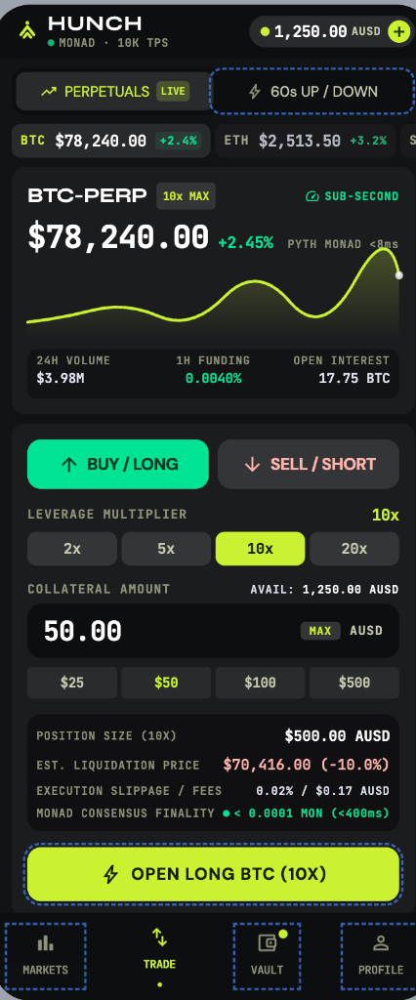
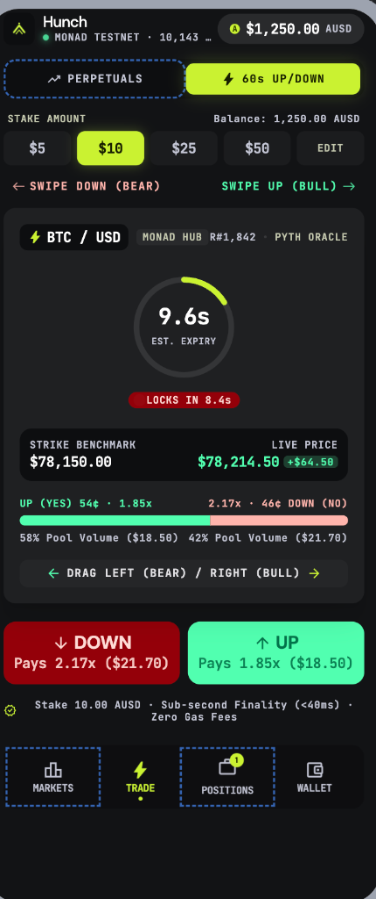
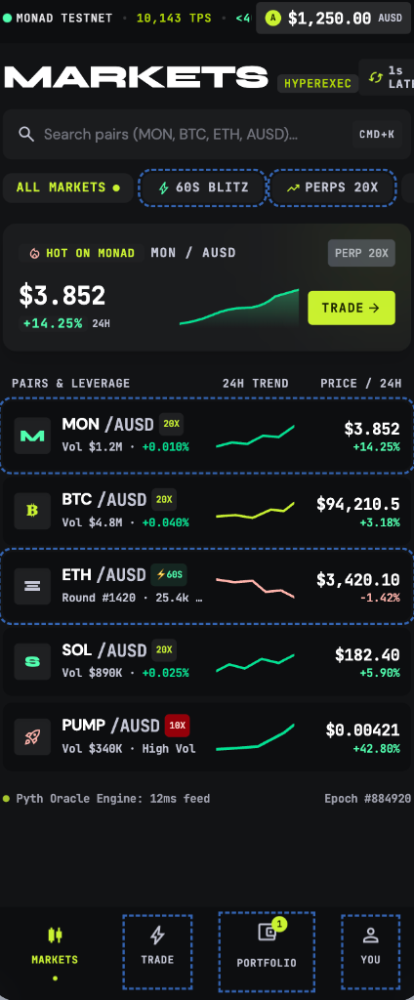
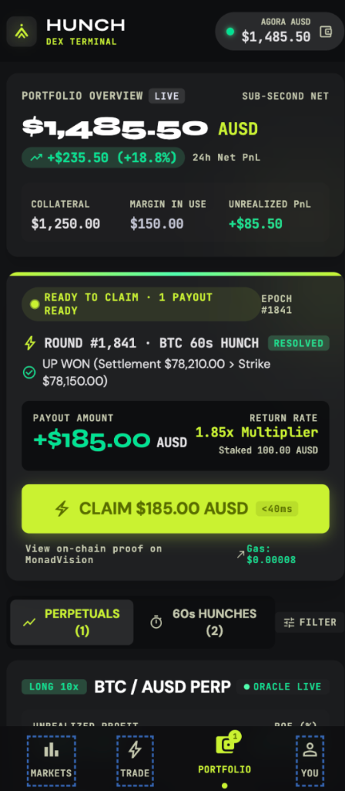
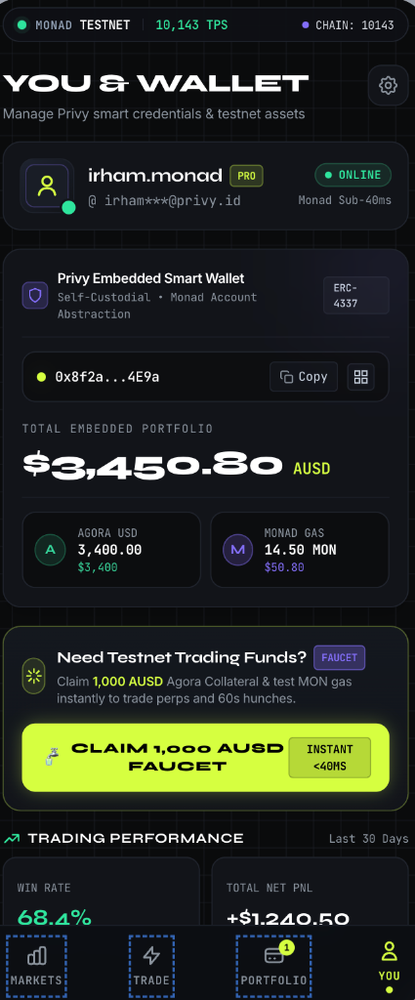

# Hunch — Mobile Trading App on Monad

Perpetual Futures (via **Perpl DEX**) + 60-Second Instant Hunches with **Agora AUSD** collateral on Monad.

**Bounties & Tracks:**
- **Best Mobile Trading App on Monad (Agora Onchain Trading Bounty)** — $10,000
- **Metropolis Track 01 (Onchain Finance & Trading)** — $10,000
- **Privy Embedded Wallets Bounty** — $5,000
- **Pyth Oracle Integration**

**Product:**
1. **Perpetual Futures (Perpl DEX)**: Long & Short leverage trading on BTC, ETH, SOL, MON using official Agora AUSD collateral on Monad Testnet.
2. **60-Second Instant Hunches**: Flagship UP/DOWN short-horizon binary markets with swipe gestures (CPMM + Pyth settlement).
3. **Unified Portfolio**: Real-time margin tracking, unrealized PnL, and 1-tap claim for winning hunch payouts.
4. **Non-Custodial Mobile Auth**: Privy email OTP with embedded EOA created on Monad Testnet.

## App Preview & Interface

| 📈 Perpetuals Hub | ⚡ 60s Swipe Hunch | 📊 Markets Explorer |
|:---:|:---:|:---:|
|  |  |  |

| 💼 Portfolio & 1-Tap Claim | 👤 Privy Wallet & Faucet |
|:---:|:---:|
|  |  |

## For judges

**One-liner:** All-in-one mobile trading app on Monad: Perps via Perpl + 60s swipe hunches with Agora AUSD.

| | Link |
|---|---|
| Judge try path | [mobile/DEMO.md](mobile/DEMO.md) |
| Full write-up | [SUBMIT.md](SUBMIT.md) |
| Form fields | [SUBMISSION_FORM.md](SUBMISSION_FORM.md) |
| Day-of ops | [OPS.md](OPS.md) |
| **Privy setup** | [PRIVY_SETUP.md](PRIVY_SETUP.md) |
| **Perks Quicknode / Tenderly / Zerion** | [PERKS.md](PERKS.md) |
| **Agora bounty (AUSD+Perpl)** | [AGORA_BOUNTY.md](AGORA_BOUNTY.md) — testnet stack + eligibility |
| **EAS / device** | [EAS_SETUP.md](EAS_SETUP.md) |
| Landing page | [site/index.html](site/index.html) (GitHub Pages: Settings → Pages → `/site`) |
| Video outline | [DEMO_VIDEO_SCRIPT.md](DEMO_VIDEO_SCRIPT.md) |
| Mobile / EAS | [mobile/README.md](mobile/README.md) |

Preflight + smoke:

```bash
npm run doctor       # env + repo readiness (secrets never printed)
npm run api          # terminal 1
npm run keeper       # terminal 2
npm run smoke:demo   # terminal 3 — PASS/FAIL health + config + current round
```

---

## Try in 2 minutes

1. Open the app on a phone or dev client (`cd mobile && npx expo start --dev-client`).
2. Log in with **email OTP** (Privy creates an embedded Monad wallet).
3. Tap **YOU** tab -> **Claim Agora AUSD + Gas MON** (official Agora AUSD `0xa901...22dc`).
4. On **TRADE**:
   - Tap **📈 PERPETUALS**: Pick BTC/ETH, choose BUY / LONG, select 10x leverage, and tap **OPEN LONG**.
   - Tap **⚡ 60s UP/DOWN**: Swipe **right = UP**, **left = DOWN** for quick 60s hunch.
5. In **PORTFOLIO**:
   - View live Perpl perpetual positions & PnL, or close position.
   - Claim winning hunch payouts in Agora AUSD.

---

## Architecture

```
iOS Expo (mobile/) — Privy email OTP + embedded wallet
        ↓
API :8787  ·  Perpl proxy, quotes, faucet, relayed executeBuy
        ↓
Perpl Testnet (0x1964C...80cc)  ·  Perpetual CLOB orders + margin
HunchVault (LP) → HunchFactory → HunchMarket  +  Pyth Oracle + Agora AUSD
```

---

## Contracts & Integrations (Monad testnet 10143)

| Protocol | Contract / Resource | Address / URL |
|---|---|---|
| **Agora AUSD** | Official Testnet Token | [`0xa9012a055bd4e0eDfF8Ce09f960291C09D5322dC`](https://testnet.monadvision.com/address/0xa9012a055bd4e0eDfF8Ce09f960291C09D5322dC) |
| **Agora Faucet** | Official Testnet Faucet | [`0xd236c18D274E54FAccC3dd9DDA4b27965a73ee6C`](https://testnet.monadvision.com/address/0xd236c18D274E54FAccC3dd9DDA4b27965a73ee6C) |
| **Perpl DEX** | Exchange Contract | [`0x1964C32f0bE608E7D29302AFF5E61268E72080cc`](https://testnet.monadvision.com/address/0x1964C32f0bE608E7D29302AFF5E61268E72080cc) |
| **Perpl API** | Testnet REST & WS | `https://testnet.perpl.xyz/api` |
| **Hunch Factory** | 60s Round Spawner | [`0x9b708E57B0a51d03207b0c65392D50de40e1B250`](https://testnet.monadvision.com/address/0x9b708E57B0a51d03207b0c65392D50de40e1B250) |
| **Hunch Vault** | LP & Residual Pool | [`0xe064D0B2edE1891ebD0F815eDADd45541c62C927`](https://testnet.monadvision.com/address/0xe064D0B2edE1891ebD0F815eDADd45541c62C927) |
| **Pyth Oracle** | Price Feeds | [`0x2880aB155794e7179c9eE2e38200202908C17B43`](https://testnet.monadvision.com/address/0x2880aB155794e7179c9eE2e38200202908C17B43) |

---

## How to run

### 0. Root env

```bash
cp .env.example .env   # PRIVATE_KEY (testnet deployer) + PYTH_API_KEY
npm install
```

### 1. Backend (keeper + API)

```bash
npm run deploy:vault   # once — Factory + Vault + fund LP
npm run keeper         # auto open → resolve loop
npm run api            # http://localhost:8787
# optional: npm run indexer
```

### 2. Mobile

```bash
cd mobile
cp .env.example .env   # set EXPO_PUBLIC_API_URL + Privy IDs
npm install
npx expo start --dev-client   # NOT Expo Go — Privy needs native modules
```

Full mobile runbook (Privy verify, EAS, TestFlight): **[mobile/README.md](mobile/README.md)**  
5-minute judge path: **[mobile/DEMO.md](mobile/DEMO.md)**

`mobile/.env`:

| Var | Purpose |
|---|---|
| `EXPO_PUBLIC_API_URL` | Phone → API. LAN IP (`http://192.168.x.x:8787`) or public ngrok/VPS URL |
| `EXPO_PUBLIC_PRIVY_APP_ID` | Privy Dashboard → App ID |
| `EXPO_PUBLIC_PRIVY_CLIENT_ID` | Privy Dashboard → mobile App Client ID |
| `EXPO_PUBLIC_USE_DEMO_AUTH` | `1` = local demo login without Privy |

**Privy Dashboard setup:** enable **Email OTP** + **Embedded wallets (Ethereum → create on login)** + add an App Client for iOS bundle `com.hunch123.app`.

### 2b. EAS / TestFlight

```bash
npm i -g eas-cli && eas login
cd mobile
eas build:configure          # first time
npm run eas:dev              # development client (internal)
npm run eas:preview          # TestFlight / ad-hoc binary
eas submit --platform ios --profile preview
```

Profiles live in `mobile/eas.json`. You need an Expo account and (for TestFlight) an Apple Developer account. Do not commit secrets; `EXPO_PUBLIC_*` is inlined at build time from the profile env or local `.env`.

> Privy needs a **development build** (`npx expo run:ios` or EAS dev client). Expo Go will not load native Privy modules.

### 3. API reachability (LAN + public)

**Same Wi‑Fi as the PC**

```powershell
ipconfig | findstr IPv4
# set mobile/.env → EXPO_PUBLIC_API_URL=http://<that-ip>:8787
```

Windows Firewall: allow inbound TCP **8787** on Private networks (or use a tunnel).

**Judges off-LAN**

```bash
# while API runs on :8787
ngrok http 8787
# mobile/.env → EXPO_PUBLIC_API_URL=https://xxxx.ngrok-free.app
# restart Metro / rebuild EAS preview with the public URL
```

Keeper must be running or HUNCH will show no live round.

---

## API

| Method | Path | Notes |
|---|---|---|
| GET | `/v1/config` | chainId, contracts |
| GET | `/v1/round/current` | live round + spot |
| GET | `/v1/round/:id` | round status |
| GET | `/v1/rounds` | indexed history |
| GET | `/v1/wallet/:address` | balances + positions |
| POST | `/v1/wallet/faucet` | mint MockAUSD + top up MON |
| POST | `/v1/quote` | `{ side, amountAUSD }` |
| POST | `/v1/tx/commit` | approve + commitBuy calldata |
| POST | `/v1/trade/execute` | relay executeBuy after delay-blocks |
| POST | `/v1/tx/redeem` | redeem calldata |
| POST | `/v1/demo/trade` | demo hot-wallet trade |
| GET | `/v1/demo/me` | demo wallet snapshot |

### Demo safety (rate limits)

In-memory limits (reset on API restart) so mid-demo spam cannot drain the hot wallet:

| Endpoint | Policy |
|---|---|
| `POST /v1/wallet/faucet` | Cap **1000 AUSD**/req · MON **0.05** only if &lt; **0.02** · 1 / address / 10 min · already funded → 200 `alreadyFunded` |
| `POST /v1/demo/faucet` | Same mint caps · 4 / IP / 10 min |
| `POST /v1/trade/execute` | 4 / trader / min · 12 / IP / min · market must be a recent factory round · single in-flight execute |

429 body: `{ "error": "...", "retryAfterSec": N }`.

---

## Local contracts

```bash
npm install
npm test
npm run simulate
```

---

## Demo vs production

| | Demo (hackathon) | Production |
|---|---|---|
| Collateral | MockAUSD mintable | Agora AUSD |
| Auth | Privy email OTP + embedded wallet | same + passkeys / session keys |
| Gas | Faucet MON on testnet | paymaster / gas sponsorship (ZeroDev) |
| Execute | API hot-wallet relays `executeBuy` | user or decentralized keepers |
| RPC | public Monad testnet | dedicated RPC |
| Indexer | file store + Envio scaffold | Envio full indexer |

---

## Track callouts

- **Agora Mobile** — iOS-first Expo app, AUSD collateral shape.
- **Privy** — email OTP login, embedded wallet is the trader of record.
- **Pyth** — BTC/USD strike + settlement on Monad.
- **Monad** — 60s rounds, low latency commits.

---

## Mobile tabs

**HUNCH** (play) · **BOOK** (positions / claim) · **YOU** (wallet, faucet, logout)

Auth lives under `mobile/app/(auth)`.

## Judge try path

See [mobile/DEMO.md](mobile/DEMO.md) — email OTP → fund → swipe → resolve → claim → MonadVision link.

## Mentor day-of

Full checklist: **[OPS.md](OPS.md)**

1. Fund root `PRIVATE_KEY` with MON on Monad testnet
2. Vault funded (`npm run deploy:vault` if needed)
3. `npm run api` + `npm run keeper`
4. Privy App ID + Client ID in `mobile/.env` (rebuild/restart Metro)
5. Tunnel URL if judges are off-LAN
6. Smoke: Fund twice → second is no-op/429 · Trade → Claim → explorer opens
